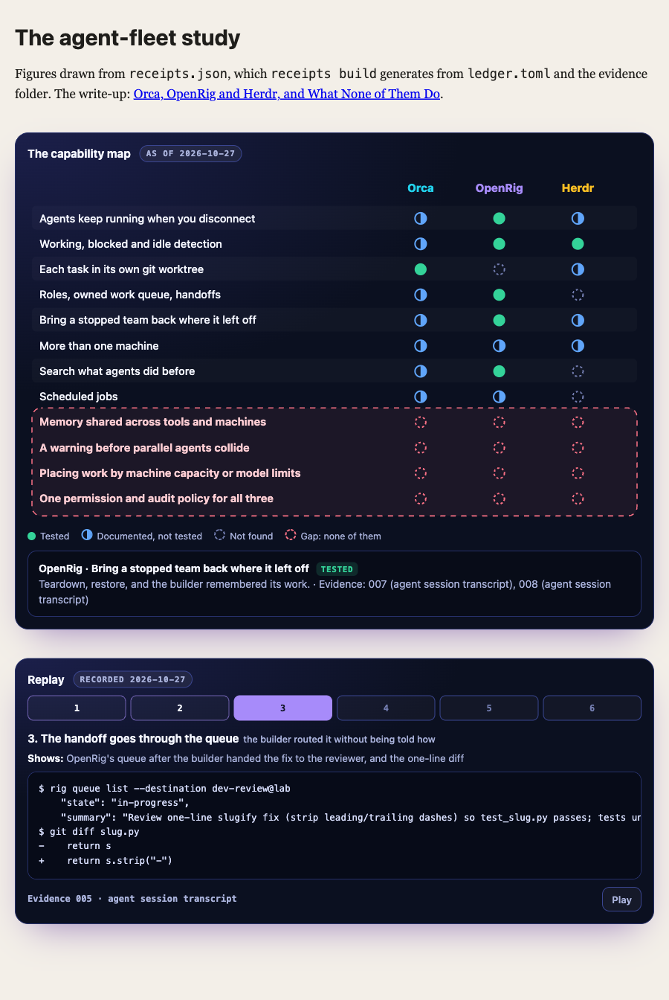

# receipts

**Write tool comparisons you can prove.**

`receipts` is a small command-line tool and a Claude Code skill for writing truthful "I tested these tools" posts. You run the tools, keep their output word for word, and give every claim one of three labels:

| Label | Means | Must cite |
|---|---|---|
| **Tested** | You ran it and saw it | Evidence, plus the exact lines a reader will see |
| **Documented** | The project says so, and you didn't test it | A URL or CLI help, with version |
| **Not found** | You looked and it isn't there | Where you looked |

Then `receipts` checks the claims. It refuses a "tested" claim without evidence, and an excerpt that isn't in that evidence word for word. It checks every quote against its live source page. The figures are built from the same data, so they can't claim more than you can back up.

It was extracted from how this post was made: **[Orca, OpenRig and Herdr, and What None of Them Do](https://ry-ops.dev/posts/2026-10-27-orca-openrig-herdr-what-none-of-them-do/)**. That study ships here as the worked example, in [`examples/agent-fleet`](examples/agent-fleet).



## Install

You need [uv](https://docs.astral.sh/uv/) or Python 3.11+. There are no other dependencies.

```sh
uv tool install git+https://github.com/ry-ops/receipts
# or run it once without installing
uvx --from git+https://github.com/ry-ops/receipts receipts --help
```

## Use

```sh
receipts new studies/my-comparison --title "Tool A vs Tool B"

# capture evidence: runs the command, shows the output, saves it word for word
receipts run studies/my-comparison tool-a-sync -r "Tool A syncing the lab repo" -- tool-a sync ./lab

# anything you can't capture directly gets labeled with what it is and what it shows
pbpaste | receipts note studies/my-comparison tool-b-dialog --kind screen -r "Tool B's approval dialog"
receipts note studies/my-comparison tool-b-window --kind screenshot --file ~/Desktop/shot.png -r "Tool B's window with two agents running"

# fill in ledger.toml, then:
receipts quotes studies/my-comparison   # every quote, checked against its source page
receipts check  studies/my-comparison   # every claim, checked against the evidence
receipts build  studies/my-comparison   # receipts.json for figures, receipts.md for the post
```

`receipts check` exits non-zero on any error, so it works in CI. `receipts build` won't build until `check` passes, unless you add `--force` for a draft.

## Evidence

Every piece of evidence says what kind of record it is and, in one sentence, what it shows.

| Kind | Made by | Means |
|---|---|---|
| `run` | `receipts run` only | Captured live: stdout and stderr, command, exit code |
| `transcript` | `receipts note --kind transcript` | Copied from an agent session's transcript |
| `screen` | `receipts note --kind screen` | Text read off a TUI, a dialog or a status line |
| `formatted` | `receipts note --kind formatted` | A tool's real output, reformatted by your script |
| `screenshot` | `receipts note --kind screenshot --file img.png` | An image of a screen, with its description |
| `note` | `receipts note` | Anything else you typed in |

Only `receipts run` can produce `run`, so a reader can tell a live capture from a copy. Fix a label later with `receipts relabel STUDY ID --kind ... -r "..."`.

### Local paths

Real paths are replaced before anything is saved, so evidence can be published without your home folder in it. Set the stand-ins in `ledger.toml`, written with `~` so the real path is never stored:

```toml
[redact]
"~/Projects" = "~/ry-ops/projects"
"~" = "~/ry-ops"
```

Each file's header records that paths were replaced and with what, never the original. `receipts redact STUDY` applies the table to evidence you already have, and `receipts check` fails if a real home-folder path is left anywhere.

## The ledger

One `ledger.toml` per study. Here's a trimmed version of the example:

```toml
[study]
title = "Orca, OpenRig and Herdr, and What None of Them Do"
date = "2026-10-27"
tester = "Claude Code"
not_tested = "anything across two machines; ..."

[[subject]]
id = "openrig"
name = "OpenRig"
version = "0.7.4"

[[capability]]
id = "restore"
label = "Bring a stopped team back where it left off"
[capability.cells]
openrig = { status = "tested", evidence = ["007", "008"], excerpt = "Original verdict: fully_restored", note = "..." }
orca    = { status = "documented", source = "https://onorca.dev/", note = "..." }
herdr   = { status = "documented", source = "https://herdr.dev/", note = "..." }

[[capability]]
id = "shared-memory"
label = "Memory shared across tools and machines"
gap = true   # a claim that none of them do it: every cell must be not-found
[capability.cells]
# ...

[[quote]]
text = "Herdr is where your coding agents live"
url = "https://herdr.dev/"

[[step]]   # one step of the replay figure
title = "Restore it, then ask what it remembers"
evidence = ["008"]
```

### What `check` refuses

- A `tested` claim with no evidence, or citing evidence that doesn't exist.
- An `excerpt` that doesn't appear in the cited evidence. Quotes, dashes, spacing and case are normalized; wording isn't.
- A `documented` claim with no source.
- A `not-found` claim that doesn't say where you looked.
- A `gap` row with anything other than `not-found` in it.
- A subject without an exact version, or a row missing a subject.
- A quote that `receipts quotes` couldn't find on its page. Bot-check pages are reported as blocked, never as found.
- Evidence of an unknown kind, a screenshot with no image, or a real local path left in published evidence. Evidence with no description is a warning.

## Figures

[`figures/receipts-figures.js`](figures/receipts-figures.js) and its CSS draw two animated, interactive figures from `receipts.json`. They have no dependencies and honor reduced motion.

- **matrix** shows the capability map. Click any dot to see the note, evidence ids or source behind it. Gap rows are outlined.
- **replay** steps through a test run, one evidence excerpt or screenshot per step. Each step shows what its evidence represents and what kind of record it is.

```html
<link rel="stylesheet" href="receipts-figures.css">
<script src="receipts-figures.js" defer></script>
<div class="rcpt" data-rcpt="matrix" data-src="receipts.json"><p>Text fallback.</p></div>
<div class="rcpt" data-rcpt="replay" data-src="receipts.json"><p>Text fallback.</p></div>
```

To see them on the example, run `python3 -m http.server` in this folder and open `examples/agent-fleet/`.

## With Claude Code

The repo includes a skill at [`.claude/skills/receipts/SKILL.md`](.claude/skills/receipts/SKILL.md). Copy it into `~/.claude/skills/` or your project's `.claude/skills/`. It gives Claude Code the workflow and the rules the post was written under. Two examples: tested means you ran it, and lines your own script added are labeled as yours.

## The method

[`docs/method.md`](docs/method.md) explains the whole approach, including the parts a tool can't check.

## Honesty note on the example

The evidence in `examples/agent-fleet` was copied from the October 27, 2026 test session's Claude Code transcript after the fact. So 17 files are `kind: transcript`, and 2 are `kind: formatted`, where the test script reformatted a tool's JSON. None are `kind: run`. Lines the test script added, like formatting or timing, are marked inside the evidence. Local paths are shown as `~/ry-ops`, and each affected file's header says so. The quotes were re-checked against their live pages with `receipts quotes`, and the results are in `quotes.lock.json`.

## License

MIT
